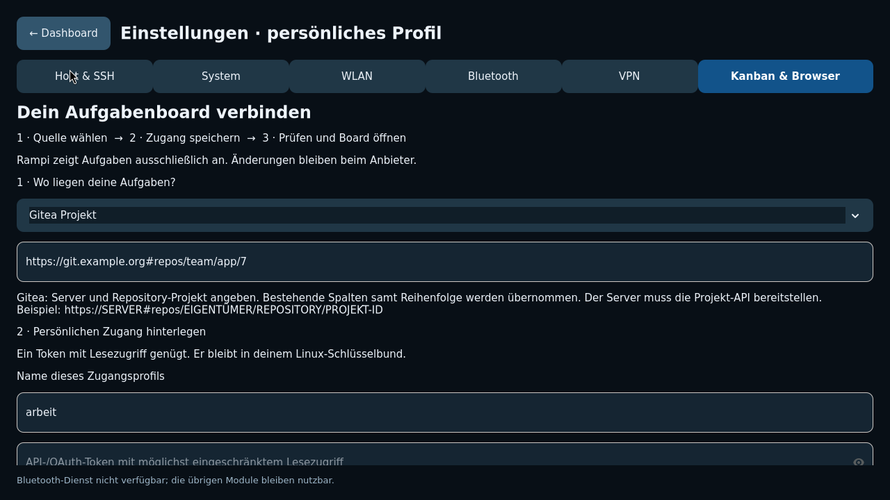

# Kanban in Rampi einrichten

Öffne **Einstellungen → Kanban & Browser**. Die Oberfläche führt durch drei
Schritte und bleibt dabei im Rampi-Fenster. Aufgaben werden ausschließlich gelesen.

1. Wähle den Anbieter und trage die Quellenkennung ein. Der Hinweis zeigt nur
   das Format des ausgewählten Anbieters. Optional kannst du Spalten sortieren.
2. Gib deinem persönlichen Zugang einen Profilnamen, beispielsweise `arbeit`.
   Speichere einen möglichst eingeschränkten Lese-Token im System-Schlüsselbund.
   Bei einer lokalen Datei entfällt dieser Schritt. Die Eingabefelder werden
   beim Speichern geleert. Ein gesperrter Schlüsselbund öffnet keinen Dialog:
   zuerst die normale Linux-Sitzung entsperren.
3. Speichere die Datenquelle, wähle **Gespeichertes Board prüfen**, danach
   **Board öffnen →**. Der Prüfstatus unterscheidet eine geladene Quelle von
   Offline-Daten. Die Filter für Suche, Projekt, Priorität und Status kombinieren
   sich; leere Filter zeigen alle Werte.

| Anbieter | Quellenkennung | Zugang und Darstellung |
|---|---|---|
| Lokale Datei | `~/aufgaben.json` | Kein Token; normalisiertes Board-JSON |
| GitHub Projects | `organization/NAME/NUMMER` oder `user/NAME/NUMMER` | Token mit Zugriff auf das Projekt und dessen Inhalte; Status/Priorität aus Projektfeldern |
| Gitea | `https://SERVER#repos/EIGENTÜMER/REPOSITORY/PROJEKT-ID` | Token mit Lesezugriff auf das Repository-Projekt; vorhandene Projektspalten und deren Reihenfolge, einschließlich leerer Spalten |
| Trello | Board-ID | API-Key und Token; offene Listen und Karten |
| Jira Cloud | `https://SITE.atlassian.net#PROJEKT` | E-Mail und API-Token mit Issue-Lesezugriff |
| Jira OAuth | `https://api.atlassian.com/ex/jira/CLOUD-UUID#PROJEKT` | OAuth-Token mit Issue-Lesezugriff; E-Mail leer lassen |
| Asana | Numerische Projekt-ID | Token mit Projekt-/Aufgaben-Lesezugriff; Abschnitt des ausgewählten Projekts, erledigte Aufgaben in „Erledigt“ |
| Notion | Data-Source-ID | Data Source für die Integration freigeben; Titel- und Status-Eigenschaft |

Gitea unterstützt HTTPS-Server mit optionalem Port und Installationspräfix,
beispielsweise `https://git.example.org:8443/gitea#repos/team/app/7`.
Die Repository-Projekt-API muss auf der Instanz verfügbar sein; ältere Server
ohne diese Endpunkte liefern einen erklärten Fehler. Organisations- und
persönliche Gitea-Projekte sind in dieser ersten Anbindung nicht unterstützt.
Es gibt keinen stillen Ersatz durch ein anders aufgebautes Issue-Board.

Tokens liegen im vorhandenen Secret Service mit den Attributen
`application=rampi`, `profile=PROFILNAME`, `provider=ANBIETER` und der exakten
Quellenkennung `source`. Derselbe Profilname überträgt damit keinen Token an
einen anderen Anbieter oder Gitea-Server. Nach einem Quellenwechsel den Zugang
für diese Quelle ausdrücklich erneut speichern. Sie stehen weder in Einstellungen
noch in Prozessargumenten, URLs oder Cache-Dateinamen. Netzwerkzugriffe verwenden
das installierte curl mit Zertifikatsprüfung und ohne automatische Weiterleitung.
Die Anwendung verändert keine Tickets, Spalten oder Anbieterberechtigungen.

Normalisierte Boards werden atomar unter
`$XDG_CACHE_HOME/rampi/boards/` gespeichert, sonst `~/.cache/rampi/boards/`.
Verzeichnisse sind privat (0700), Dateien 0600. Anbieter, Quelle und Profilname
bilden gemeinsam die Cache-Identität. Ein Quellen- oder Profilwechsel übernimmt
keine Daten des vorherigen Boards. Bei Ausfall erscheint ausschließlich der
passende Offline-Cache mit sichtbarer Kennzeichnung. Dieser Cache enthält
Aufgabentexte im persönlichen Linux-Konto; ein gesperrter Schlüsselbund
verschlüsselt vorhandene Cache-Dateien nicht nachträglich.

Antworten und Paginierung sind begrenzt. Fehlerhafte oder wiederholte Seiten,
doppelte Karten, unvollständige Ergebnisse und zu große Antworten ersetzen kein
gültiges Board. Gitea liest bis zur leeren Seite weiter, auch wenn der Server
kleinere Seiten liefert als angefordert.

Die Docker-Abnahme nutzt tatsächliche GTK-Seiten, curl mit lokal vertrauenswürdigem
HTTPS-Zertifikat und einen echten verschlüsselten GNOME-Schlüsselbund. Die sechs
Anbieterdienste liefern dabei ausdrücklich Testantworten. Geprüft werden unter
anderem Paginierung, Gitea-Spalten, Profiltrennung, Offline-Cache, gesperrter
Schlüsselbund, Weiterleitungs-/Größenfehler und das Ausbleiben weiterer Fenster.
Persönliche Cloudkonten oder eine echte Gitea-Instanz werden damit nicht behauptet.

Offizielle Schnittstellen:
[Gitea-Projektspalten](https://docs.gitea.com/api/operations/repo-list-project-columns/),
[Gitea-Spaltenaufgaben](https://docs.gitea.com/api/operations/repo-list-project-column-issues/),
[GitHub Projects](https://docs.github.com/en/graphql/reference/projects),
[Trello](https://developer.atlassian.com/cloud/trello/rest/api-group-boards/),
[Jira](https://developer.atlassian.com/cloud/jira/platform/rest/v3/api-group-issue-search/),
[Asana](https://developers.asana.com/reference/gettasksforproject),
[Notion](https://developers.notion.com/reference/query-a-data-source),
[Secret Service](https://specifications.freedesktop.org/secret-service/latest-single/).

## Tatsächliche Oberfläche

Aufnahme der Rust-Anwendung unter Wayland, 1280×720, mit einer Beispielquelle.
Der aktive Tab ist hervorgehoben. Das Formular lässt sich weiter nach unten
scrollen. Die isolierte Aufnahme enthält keine persönlichen Zugänge und keine
verbundenen Systemdienste.
