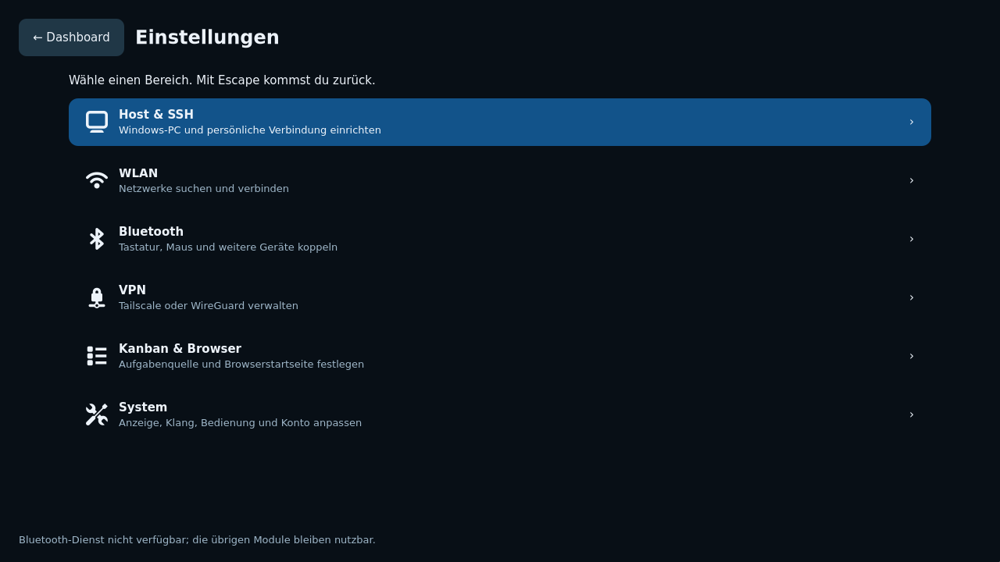

# Rampi mit Rust und Wayland bedienen

Diese Anleitung gilt für den Entwicklungszweig mit `rampi-native`. Das öffentliche
Release v0.5.0 enthält noch den früheren Python-/QML-Prototyp. Ein reguläres natives
Release ist weiterhin gesperrt. Physische Hardwaretests sind auf Wunsch ausgeschlossen.

## Erster Start und Anmeldung

Die Sitzung verwendet labwc unter Wayland. Der System-Login übernimmt die
Authentifizierung über greetd und PAM; Rampi speichert kein eigenes Linux-Kennwort.
Ein grafischer Login ist noch nicht vollständig softwareseitig abgenommen.
Der reguläre TTY-Zugang bleibt vorhanden.

Beim ersten Start erscheint die Einrichtung. **Weiter / Schritt überspringen**
speichert den aktuellen Schritt. **Später fortsetzen** öffnet das Dashboard,
ohne die Einrichtung als abgeschlossen zu markieren. Über **Einrichtung fortsetzen**
im Dashboard gelangst du zurück. **Einrichtung abschließen** ist am letzten Schritt
möglich und bestätigt deinen Durchlauf; Verbindungen werden dadurch nicht als
erfolgreich geprüft markiert.

Die 15 Stationen zeigen auch fehlende Funktionen ausdrücklich an. Insbesondere
Sprachwechsel und Kontenverwaltung sind noch nicht vollständig portiert.

## Dashboard und Navigation

Pfeil links/rechts wechselt zwischen den sechs Hauptkacheln, Enter öffnet das
Modul. Tab bewegt den Fokus zwischen Bedienelementen. Escape führt von einer
Bestätigungsseite zurück beziehungsweise zum Dashboard; aus einem während der
Einrichtung geöffneten Einstellungsbereich geht es zurück zur Einrichtung.
Strg+Alt+Pos1 ist für die Rückkehr zu Rampi reserviert und wird nicht an die
Terminal-PTY weitergegeben. Im Terminal und Browser bleibt Escape für deren eigene
Bedienung verfügbar; verwende dort Strg+Alt+Pos1 für das Dashboard.

WLAN und Bluetooth erscheinen jeweils einmal oben im Dashboard. Ein Klick führt
zur zugehörigen Einstellungsseite. Suche, Kennworteingabe, Kopplung und Bestätigungen bleiben
innerhalb desselben Rampi-Fensters. Bei Tastaturbedienung verschwindet der
Mauszeiger; Mausbewegung zeigt ihn wieder.

**Einstellungen** öffnet eine vertikale Kategorieübersicht im Stil eines
Konsolenmenüs. Pfeil hoch/runter wählt eine Kategorie, Enter öffnet ihre eigene
Seite. Es gibt keine Einstellungs-Tabs. **← Einstellungen** oder Escape führt
zur Übersicht zurück und merkt sich die zuletzt gewählte Kategorie; ein weiteres
Escape öffnet das Dashboard. Während der Ersteinrichtung führt Zurück direkt
zum aktuellen Einrichtungsschritt. Alle Bereiche bleiben im selben Fenster.



Tatsächliche Wayland-Aufnahme aus der isolierten Softwareprüfung. Die dort
fehlenden Bluetooth-Dienste betreffen nur diese Aufnahmeumgebung.

Unter **System** kannst du Bewegung reduzieren und Klickklänge abschalten.
Speichere die persönlichen Einstellungen mit der entsprechenden Schaltfläche.
Unter **Eigenes Linux-Kennwort ändern** fragt das offizielle passwd im eingebetteten
Terminal nach altem und neuem Kennwort. Rampi speichert diese Eingaben nicht.
**Von Rampi abmelden** öffnet eine Bestätigungsseite. Lokale Anwendungen und
Verbindungen werden geschlossen; persistente Windows-Prozesse laufen weiter.
Die Klangwiedergabe verwendet den vorhandenen Pulse-kompatiblen Audiodienst.

Auf derselben Systemseite eine persönliche Tastaturbelegung wählen und anwenden. Andere
persönliche Compositor-Einstellungen bleiben erhalten. Das Eingabefeld dient zum
sofortigen Prüfen; bei einer fremden Sitzung gilt die Datei gegebenenfalls erst
nach der nächsten Rampi-Anmeldung. Die Oberfläche bleibt derzeit deutsch.
**Bildschirme und Auflösungen anzeigen** zeigt die vom laufenden Wayland-System
angebotenen Modi. Eine Änderung muss innerhalb von 15 Sekunden bestätigt werden;
sonst erfolgt die Rücksetzung. Die Auflösung gilt bis zur Abmeldung.

## Persönliche Windows-Hosts

Unter **Host & SSH** kannst du mehrere Profile anlegen. Wähle einen vorhandenen
Eintrag oder **Neues Hostprofil**. Trage Profilname, Hostname/VPN-IP,
Windows-Benutzername, SSH-Port, den Pfad eines vorhandenen persönlichen
SSH-Schlüssels, Projektverzeichnis und Streaming-Auflösung ein.

**Hostprofil speichern** validiert und speichert. **Ausgewählten Host verwenden**
setzt den Host für anschließend gestartete Verbindungen. Ein Wechsel der Auswahl
verwirft ungespeicherte Formularänderungen. Bereits laufende Terminals behalten
ihre bestehende Verbindung. **Entfernen vorbereiten** verlangt anschließend eine
Bestätigung; dabei werden weder Schlüsseldateien noch Daten auf Windows gelöscht.

Windows benötigt die bestehende Integration aus
[INSTALL-WINDOWS11.md](INSTALL-WINDOWS11.md). OpenSSH muss deinen persönlichen
Schlüssel akzeptieren. Der verifizierte Windows-Hostschlüssel muss bereits in
deiner persönlichen OpenSSH-Konfiguration bekannt sein. Rampi akzeptiert unbekannte
Hostschlüssel nicht automatisch.

Unterhalb der Hostprofile kannst du einen persönlichen Rampi-Schlüssel mit
OpenSSH erstellen. Die Passphrase wird im eingebetteten Terminal eingegeben.
Über **Schlüsselerstellung fortsetzen** kehrst du zum selben Prozess zurück;
vorhandene Schlüssel werden nicht überschrieben. **Rampi-Schlüssel in Formular
übernehmen** trägt den Pfad ein; anschließend das Hostprofil speichern.
**Öffentlichen Rampi-Schlüssel anzeigen** zeigt nur die öffentliche Datei zur
Übertragung in das persönliche Windows-Konto.

**Hostschlüssel des aktiven Profils prüfen** liest den Ed25519-Schlüssel mit
OpenSSH. Vergleiche den SHA256-Fingerabdruck direkt am Windows-Host oder über
einen anderen vertrauenswürdigen Kanal und gib diesen unabhängig geprüften
Wert ein. Rampi speichert nur bei Übereinstimmung. Ein bereits bekannter Host
wird nicht automatisch ersetzt. Dies ersetzt keine Windows-Anmeldung; die
Übertragung des öffentlichen Benutzerschlüssels bleibt ein ausdrücklicher Schritt.

Codex und Claude Code müssen unter deinem Windows-Konto installiert und
angemeldet sein. Die vorhandene Windows-Integration erhält Prozesse mit psmux.
Eine tatsächlich verfügbare offizielle native Antigravity-CLI ist nicht
nachgewiesen; die entsprechende Kachel ist kein Nachweis der Anbieterunterstützung.

## WLAN und Bluetooth

Auf der WLAN-Seite sucht **WLANs suchen** über NetworkManager nach verfügbaren Netzen.
Wähle das Netz, trage bei Bedarf das Kennwort ein und verbinde dich.
Bestehende Profile werden wiederverwendet. Neue Profile werden deinem
Linux-Konto zugeordnet. Unternehmensnetze benötigen ein vorhandenes geeignetes
NetworkManager-Profil. Unter **Verstecktes WLAN verbinden** die verfügbaren Adapter
anzeigen, den Adapter wählen und die exakte SSID sowie WPA2 Personal, WPA3 Personal
oder ein offenes Netz angeben. Passende vorhandene Profile werden verwendet; bei
mehreren passenden Profilen verlangt Rampi zuerst eine Bereinigung.

Auf der Bluetooth-Seite wählst du Adapter und Gerät, startest die Suche und koppelst.
Die Suche wird beim Verlassen der Seite freigegeben. Ein Codevergleich verlangt
eine bewusste Bestätigung. PIN und Passkey werden verdeckt eingegeben und nach
Bestätigung oder Abbruch geleert. Vertrauen und entfernte Kopplungen wirken
geräteweit; beachte die Bestätigungsseite. Bei einem Dienstneustart verwirft Rampi
alte Kopplungsanfragen samt Eingaben und meldet seinen Agenten erneut an.

Die bisherigen Rust-Prüfungen verwenden isolierte D-Bus-Testdienste. Sie belegen
Bedienabläufe und Schnittstellen, keine tatsächliche Funkkopplung.

## VPN

WireGuard-Profile werden über die vorhandene libnm-Bibliothek importiert und
von NetworkManager gespeichert. Die Seite zeigt ausschließlich persönliche,
eindeutig deinem Konto zugeordnete Profile. Importierte Profile verbinden sich
nicht automatisch. Wähle das Profil und verbinde beziehungsweise trenne es.
Die ursprüngliche Konfigurationsdatei bleibt erhalten.

Tailscale bleibt im selben Einstellungsbereich: Status prüfen, **Tailscale verbinden**
wählen und die systemweite Änderung auf der Bestätigungsseite freigeben. Wenn
Anmeldung erforderlich ist, **Tailscale-Anmeldung öffnen** wählen. Die offizielle
Anmeldung erscheint in einer eigenen Rampi-Seite mit temporärem Browserprofil.
**Zurück zu VPN** verwirft diese Ansicht; anschließend den Status aktualisieren.
Eine angezeigte Anmeldeseite bestätigt noch keinen erfolgreichen Tunnel.

Ein Administrator muss das tatsächlich verwendete Linux-Konto einmalig als
Tailscale-Operator freigeben, beispielsweise bewusst mit
`sudo tailscale set --operator=BENUTZER`. Rampi erweitert diese Rechte nicht selbst
und setzt bestehende Tailscale-Optionen nicht zurück. Tailscale und seine Routen
wirken systemweit. Benutzerkonten des Anbieters werden von dessen Anmeldung geprüft.
Headscale und eigene Login-Server sind in diesem Anmeldeweg nicht vorgesehen.

## Kanban, Browser und Remote Desktop

Unter **Kanban & Browser** führt die Einrichtung durch **Quelle → Zugang → Prüfung**.
Eine lokale JSON-Datei sowie GitHub, Gitea, Trello, Jira, Asana oder Notion sind
verfügbar. [Quellenformate und Zugang einrichten](KANBAN-NATIVE.de.md).
Das Kanban-Modul bleibt schreibgeschützt. Suche sowie Projekt-, Prioritäts- und
Statusfilter lassen sich kombinieren. **Aufgaben neu laden** aktualisiert die
Quelle. Bei Fehlern erscheint der passende private Offline-Cache mit sichtbarem
Hinweis; ein Profilwechsel übernimmt keine Daten des vorherigen Boards.

Der Browser verwendet WebKitGTK mit persönlichem Profil. Er unterstützt
Adresszeile, zurück, vorwärts und neu laden. Unterstützte Webseitenabfragen
erscheinen als Rampi-Seite. HTTPS-Zertifikatsfehler werden abgewiesen. Navigationen verwenden HTTPS.
**Downloads** öffnet die integrierte Liste. Prüfe den vollständigen Zielpfad und
wähle **Download speichern** oder **Download abbrechen**. Vorhandene Dateien werden
nicht überschrieben und Dateien nicht automatisch geöffnet. Ohne Zielentscheidung
wird nach einer Minute abgebrochen; nach Abschluss lässt sich die Liste leeren.
Weitere moderne Webseiten und Geräteberechtigungen bleiben zu prüfen.

Beim Hochladen öffnet sich eine eigene **Dateien für die Webseite auswählen**-Seite.
Öffne Ordner mit Enter oder einem Doppelklick; über den Ordnerpfad kannst du
direkt wechseln. Markiere die gewünschten Dateien und bestätige **Auswählen**.
Wenn die Webseite mehrere Dateien erlaubt, funktioniert auch Strg+A in der Liste.
Der Dateitypfilter stammt von der Webseite; **Alle Dateitypen anzeigen** hebt ihn
für diese Auswahl auf. Versteckte Einträge bleiben ausgeblendet.
**Abbrechen**, Escape, Verlassen der Auswahl oder eine neue Navigation im Browser
verwerfen die ausstehende Anfrage. Ohne ausdrückliche Bestätigung bekommt die
Webseite keine neue Datei. Höchstens 128 lesbare lokale Dateien werden gemeinsam
übernommen; Ordner und Spezialdateien werden abgewiesen.

**Remote Desktop → RDP** öffnet die integrierte Windows-Desktop-Seite. Host und
Windows-Konto stammen aus dem aktiven persönlichen Profil. Gib den RDP-Port,
den unabhängig auf Windows geprüften SHA-256-Zertifikatfingerabdruck und dein
Windows-Kennwort ein. Der Fingerabdruck muss 64 Hex-Zeichen enthalten; Doppelpunkte
und Leerzeichen sind erlaubt. Das Kennwort wird nach dem Start aus dem Eingabefeld
entfernt und weder gespeichert noch als Prozessargument übergeben.

Der Fingerabdruck bezieht sich auf das tatsächliche RDP-Serverzertifikat,
**nicht auf den SSH-Hostschlüssel**. Auf Windows kann eine administrative
PowerShell den aktiven Zertifikatsbezug und dessen SHA-256 anzeigen:

```powershell
$rdp = Get-CimInstance -Namespace root/cimv2/TerminalServices -ClassName Win32_TSGeneralSetting -Filter "TerminalName='RDP-tcp'"
$certificate = Get-ChildItem 'Cert:\LocalMachine\Remote Desktop', 'Cert:\LocalMachine\My' |
    Where-Object Thumbprint -eq $rdp.SSLCertificateSHA1Hash | Select-Object -First 1
if (-not $certificate) { throw 'Aktives RDP-Zertifikat nicht gefunden.' }
$sha256 = [Security.Cryptography.SHA256]::Create()
try { ([BitConverter]::ToString($sha256.ComputeHash($certificate.RawData))).Replace('-', '').ToLowerInvariant() }
finally { $sha256.Dispose() }
```

Vergleiche diesen Wert über einen bereits vertrauenswürdigen Weg. Eine Abweichung
verhindert die Anmeldung; der angezeigte neue Wert wird nicht automatisch akzeptiert.
**← Dashboard** oder **Strg+Alt+Pos1** wechseln zurück und erhalten die Verbindung.
**Verbindung trennen** trennt RDP, ohne Windows abzumelden. Nach einem Netzabbruch
wird die Anmeldung wieder angeboten. Escape bleibt innerhalb der Desktopfläche
für den entfernten Rechner verfügbar. RDW stellt Maus, Tastatur und Zwischenablage
bereit. Die Auflösung bleibt beim Verbinden fest; die Fläche wird lokal skaliert.

Die Softwareabnahme verwendet einen echten XRDP-Testserver. Eine native Windows-
11-Pro-/NLA-Abnahme ist noch offen. Streaming verwendet weiterhin Moonlight mit
Sunshine und eine eigene Wayland-Oberfläche; die eingebettete Streaming-Fläche
bleibt offen.

## Diagnose und persönliche Daten

**Diagnose** prüft lokal das Linux-Konto, Hostprofile, verfügbare Programme und
die Erreichbarkeit der Systemdienste. Sie verändert keine Netzwerkeinstellungen
und prüft keine Windows-Anmeldung oder Anbieterzugänge.

Persönliche Einstellungen liegen unter `~/.config/rampi/settings.json`, mit
privatem Verzeichnis und Dateirechten. Der Browser verwendet ein separates
persönliches Profil. Kennwörter gehören nicht in Hostprofile oder Kanban-Dateien.
Installer und Versionswechsel übernehmen keine fremden Benutzerprofile.

Installation und Wiederherstellung: [NATIVE-OPERATIONS.de.md](NATIVE-OPERATIONS.de.md).
