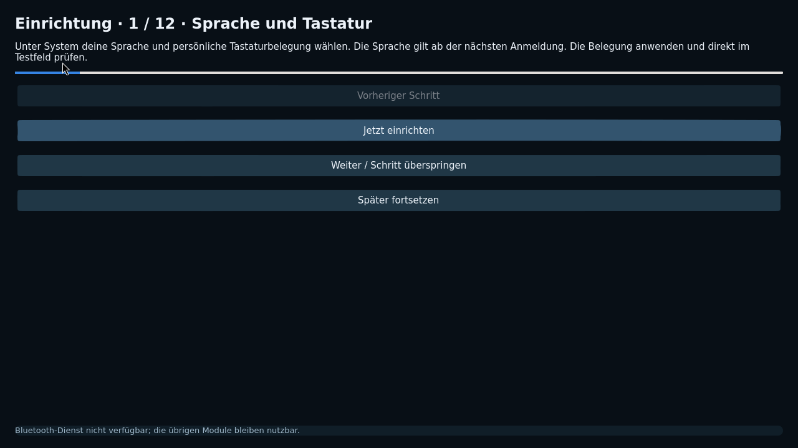
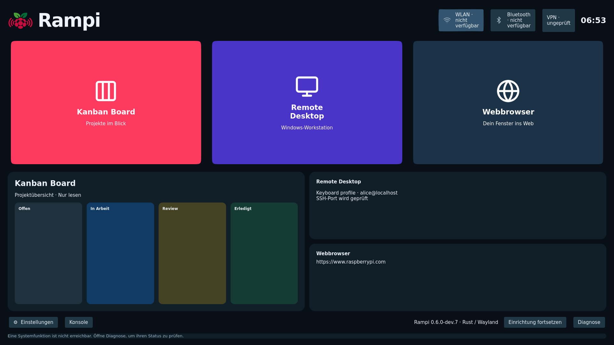
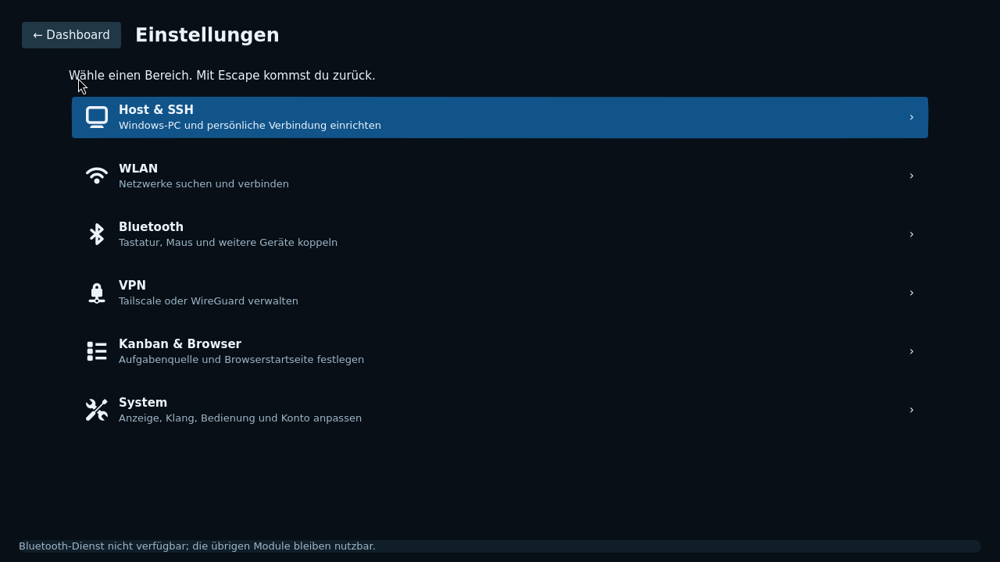
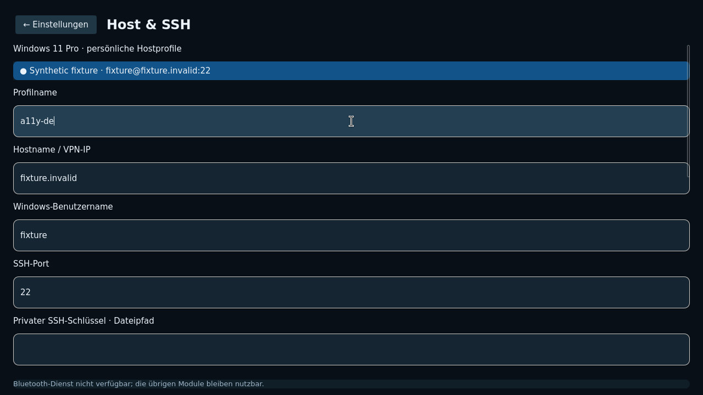
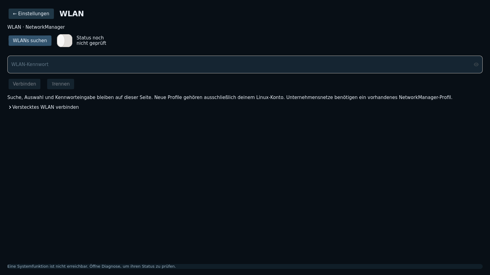
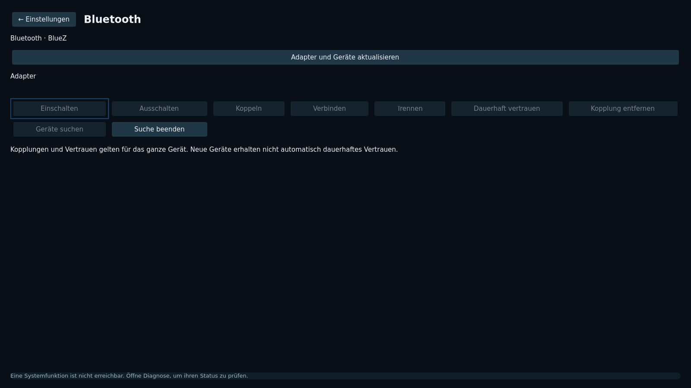
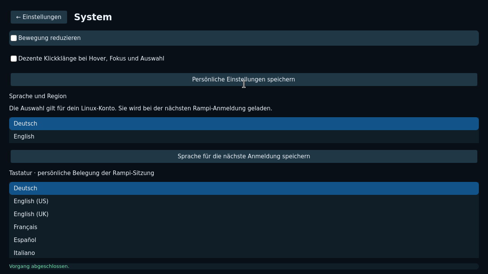
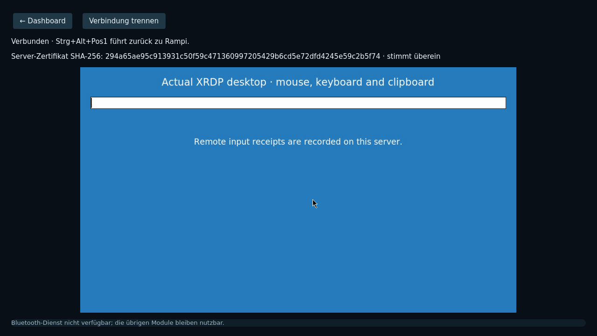
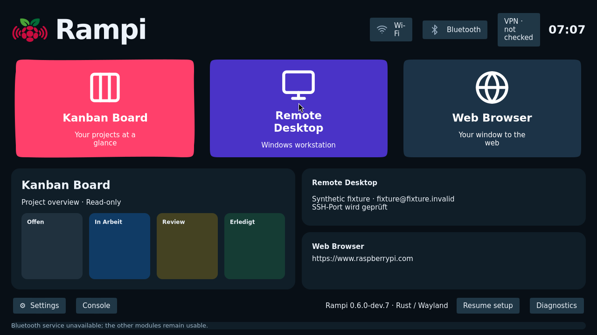

# Screenshots der nativen Rampi-Oberfläche

Stand: 3. November 2026, Entwicklungsoberfläche für **v0.6.0-dev.7**.
Die Bilder wurden aus der tatsächlich laufenden Rust-/GTK4-/Wayland-Anwendung
aufgenommen. Sie sind unverändert; keine Mockups und keine generierten Grafiken.
Sie zeigen einen lokalen Entwicklungsbuild, noch kein veröffentlichtes dev.7-Image.

Die Profile und Server sind synthetische Testdaten. `fixture` und `alice` sind
keine Standardbenutzer und keine Zugangsdaten für ein Rampi-Image. Fehlende
Funkadapter in der isolierten Umgebung werden sichtbar als nicht verfügbar
angezeigt. Der Remote-Desktop-Screenshot zeigt einen echten Linux-XRDP-Testserver,
keinen persönlichen oder externen Windows-Testhost.

Die Bilder sind keine zusätzliche Funktions- oder Hardwareabnahme. Der belegte
Produktstand bleibt **96,8 %**. [Noch offene Punkte](OFFENE-PUNKTE.de.md).

## Einrichtung: erster von zwölf Schritten

## Dashboard mit drei Modulen; synthetisches Hostprofil

## Dashboard bei 1920 × 1080; leere Kanban-Datenquelle

## Einstellungen: eine Seite je Kategorie

## Persönliches Beispielprofil fixture@fixture.invalid, keine Standardzugangsdaten

## WLAN-Seite ohne Funkadapter in dieser Testumgebung

## Bluetooth-Seite ohne Funkadapter in dieser Testumgebung

## Persönliche Einstellungen: sichtbare Erfolgsrückmeldung

## Echter eingebetteter RDP-Client mit isoliertem Linux-XRDP-Testserver; kein Windows-Rechner

## Tatsächliche englische Oberfläche

## Herkunft und Verwendung

PNG-Dateien in Originalauflösung, SHA-256-Prüfsummen und Aufnahmezuordnung stehen
im [Bildmanifest](screenshots/native-dev7/manifest.json). Die zusätzliche frische
Deutsch-/Englisch-Aufnahme besteht den tatsächlichen Speichern-/Zurückwechseltest
und die Prüfung der sichtbaren Rückmeldung innerhalb der Bildschirmgrenzen.

Die Galerie liegt bewusst in einem getrennten Dokumentationszweig. Dadurch bleibt
der bereits laufende Release-Kandidat unverändert. Vor einer Übernahme in die
Dokumentation eines veröffentlichten Images ist dessen Versionsstand abzugleichen.
