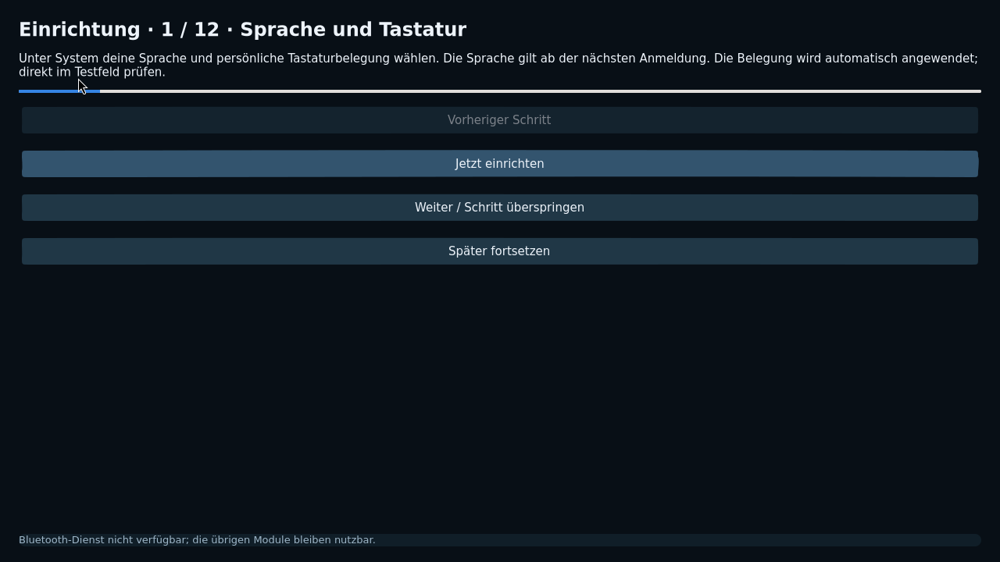
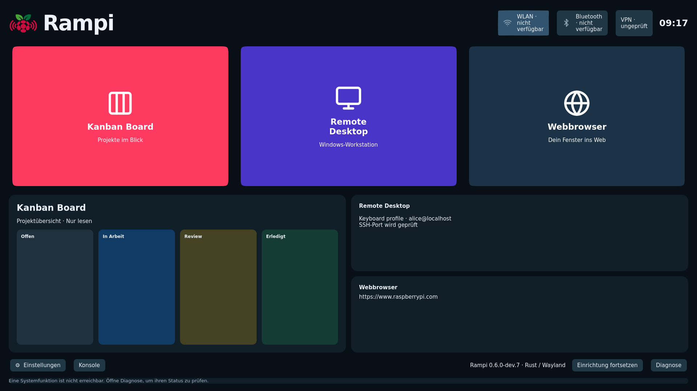
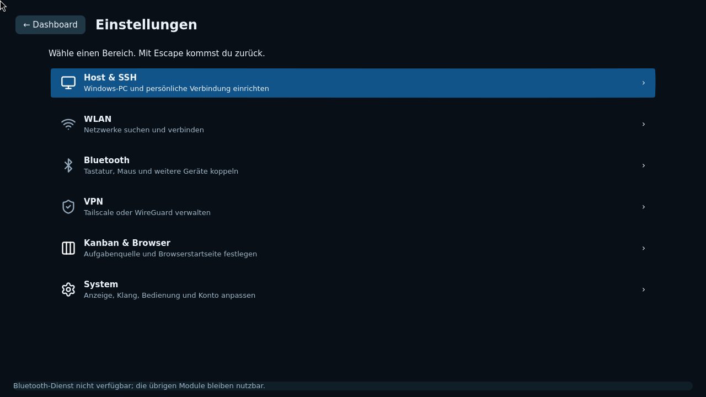
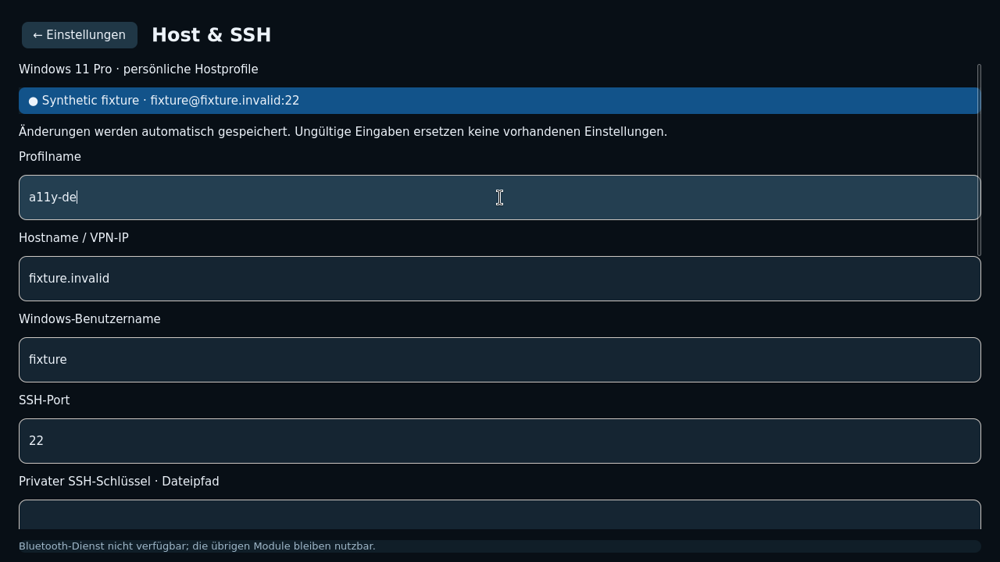
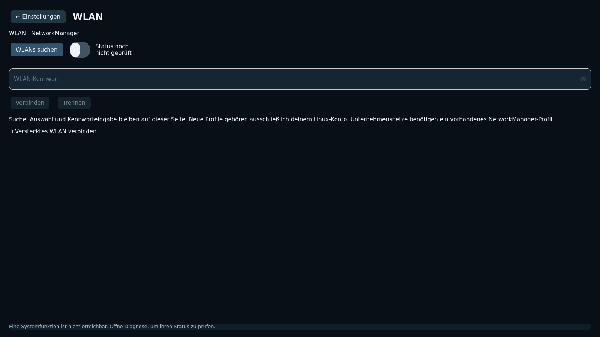
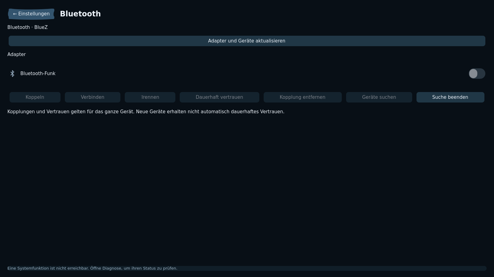
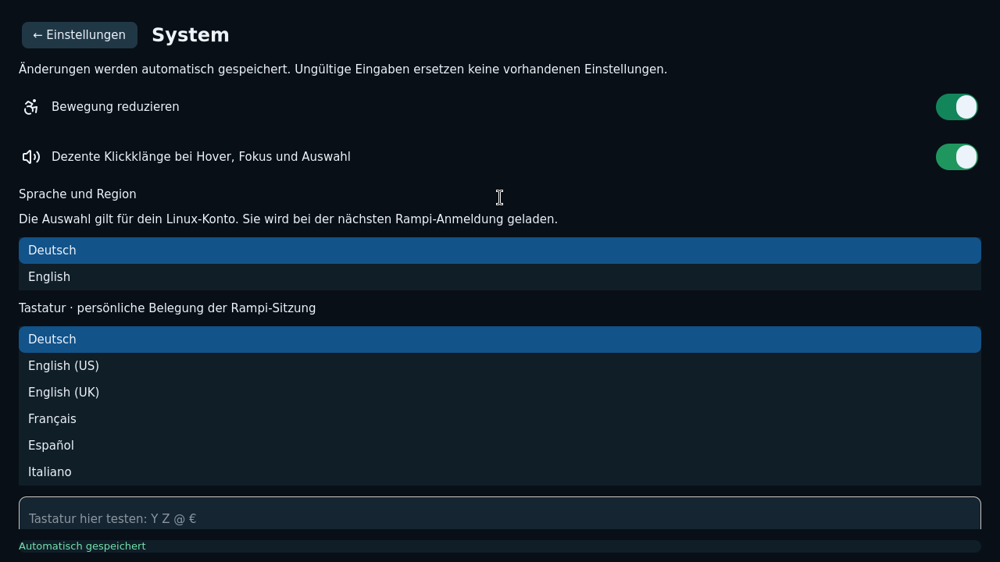
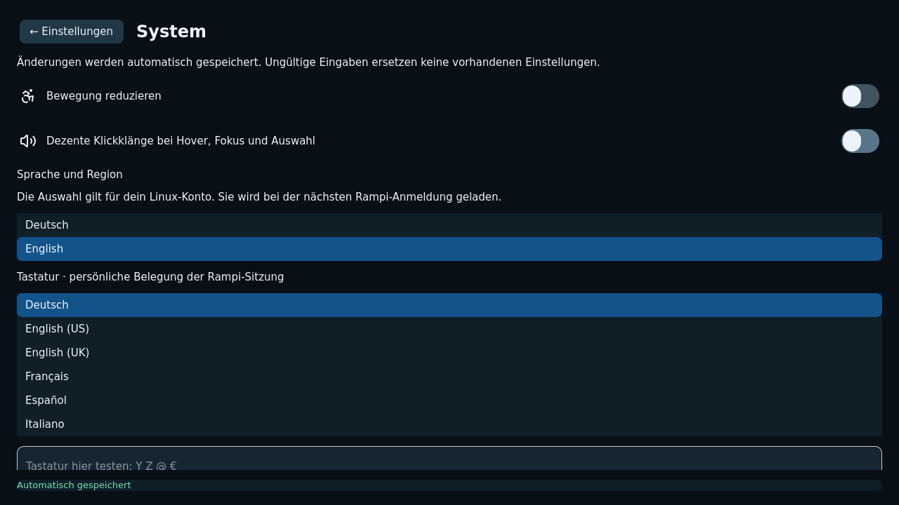
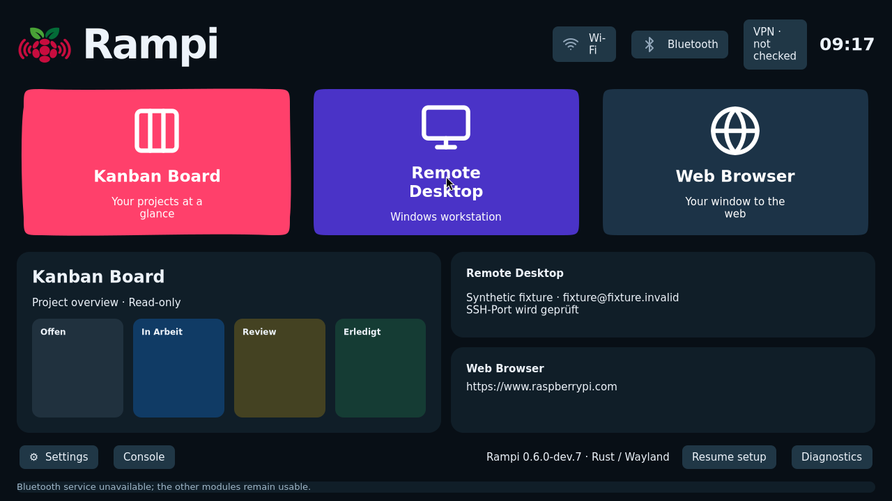
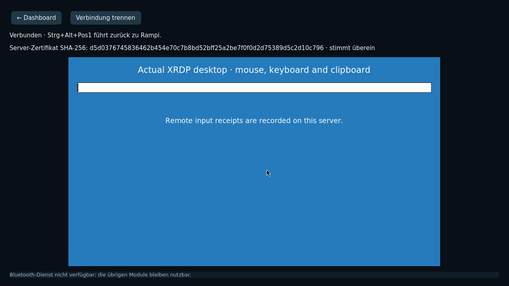

# Screenshots der nativen Entwicklungsoberfläche

Echte, unveränderte GTK-/Wayland-Aufnahmen; keine Mockups.
Die Profile und Server sind synthetische Testdaten, keine Standardzugänge.
Funkadapter können in dieser isolierten Umgebung fehlen. Ein vorhandenes
RDP-Bild zeigt einen Linux-XRDP-Testserver, keinen persönlichen Windows-PC.
Diese Bilder sind keine Image- oder Raspberry-Pi-Hardwareabnahme.

## Einrichtung – zwölf geführte Schritte

## Dashboard – drei Hauptmodule

## Dashboard bei 1920 × 1080

## Eine Seite je Kategorie

## Persönliches synthetisches Hostprofil

## WLAN – native Schalter und integrierte Suche

## Bluetooth – Adapter und native Schalter

## Eingeschaltete Schiebeschalter

## Ausgeschaltete Schiebeschalter

## Sichtbare Erfolgsrückmeldung

## Englische Oberfläche

## Echter RDP-Client mit Linux-XRDP-Testserver

[Herkunft und SHA-256-Prüfsummen](manifest.json)
