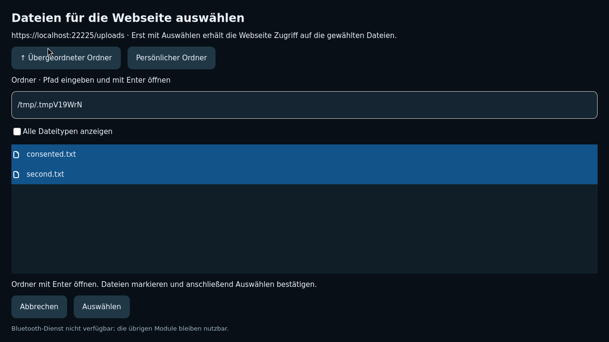

# Native Browser-Dateiauswahl

Gesamtstand weiterhin **75 / 100**. Diese Erweiterung schließt weitere Browser-
und Navigationslücken, ersetzt aber keine noch offene Geräteberechtigungsabnahme.

## Implementiert

Eine eigene Seite mit GTK DirectoryList, FilterListModel, SortListModel und
SingleSelection beziehungsweise MultiSelection ersetzt die bisherige einzelne
Pfadzeile. GIO/GTK übernehmen asynchrones Einlesen und Modellverwaltung.
Ordnernavigation, Ordnerpfad, Dateitypfilter und ausdrückliche Übernahme bleiben
im Rampi-Fenster. GTK FileChooserWidget wurde im tatsächlichen Wiederholungstest
wegen kritischer GTK-Fehler und Absturz verworfen; FileDialog würde ein zusätzliches
Fenster öffnen. Die implementierte Alternative verwendet bestehende GTK-Modelle.

Anfragen werden beim Abbrechen, Verlassen der Seite und einer neuen Browser-
Navigation verworfen. Es werden höchstens 128 lesbare lokale reguläre Dateien
übernommen. Die Auswahl ist während des Ladens und bei Ordnerfehlern gesperrt.

## Tatsächliche Softwareprüfung

`artifacts/rust-browser-upload` enthält die vollständige erfolgreiche native
Docker-/Wayland-Abnahme, 19 Rust-Core-Tests, Format und Clippy ohne Warnungen.
Der getestete Arbeitsstand basiert auf `d02d290`, Snapshot-SHA256:
`d298a7c410bb4c3f177b13a03683a3bd34bec84af39a68974a0ee422f6626995`.
Der Gesamtlauf meldet alle geforderten Nachweise einschließlich
`RAMPI_RUST_BROWSER_UPLOAD_CONSENT_OK` und 600 Modulwechseln bei 1 GiB ohne Swap.
Der separate Browserlauf in `artifacts/browser-upload/browser.log` bestätigt:

- Tatsächliches WebKit mit lokal vertrauenswürdigem HTTPS, keine Anbieter-Fixture
  für Dateiauswahl oder Übertragung: Ein HTML-Dateifeld wird per Wayland-Tastatur geöffnet.
- Eine gewählte Datei bleibt vor Bestätigung für die Webseite unsichtbar.
- Verlassen der Auswahl verwirft die Anfrage; erneutes Öffnen funktioniert.
- Nach Bestätigung liest WebKit den wirklichen Dateiinhalt und sendet ihn per
  HTTPS an den lokalen Testserver, der die Bytes prüft.
- Tatsächliches Strg+A markiert zwei Dateien; WebKit erhält beide erst nach Zustimmung.
- Eine Navigation während der Auswahl schließt die ausstehende Anfrage.
- Genau ein Anwendungsfenster, keine kritischen GTK-Fehler.
- Bestehende Zertifikatsfehler-, HTTP-Abweisungs-, JavaScript- und Downloadfälle
  bleiben erfolgreich.

Die Aufnahme zeigt den privaten temporären Testordner. Physische Hardwaretests
bleiben gemäß Nutzerauftrag ausgeschlossen.
