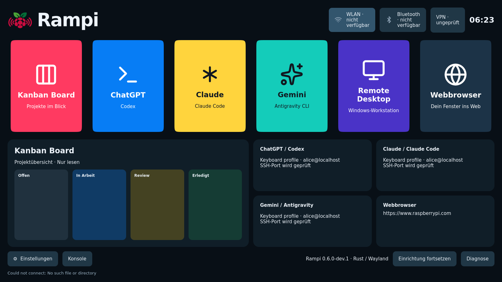

# Native Softwareabnahme am 70-Prozent-Meilenstein

Geprüfter Programm-, Dienst-, Installer- und Testquellstand:
`0c87fbb46018e1a3a8bd002ebbbd950c66b55a7b`.

- [Rust-/Wayland-CI: amd64 und ARM64](https://github.com/jtracht/rampi-os/actions/runs/39910781879).
- [Alle sechs ergänzenden CI-Jobs](https://github.com/jtracht/rampi-os/actions/runs/39910781878).

Beide vollständigen Archive `rust-wayland-amd64` und `rust-wayland-arm64` sind
heruntergeladen und unabhängig mit `scripts/check-native-evidence.py` erneut
geprüft; ARM64 zusätzlich mit `--require-installer`. Verlangt werden alle
20 Laufzeitmarker, echte PNG-Dateien mit erwarteten Auflösungen, Vierkanten-
Messwerte, PAM-/HTTPS-Nachweise, Dienstverträge, WireGuard-Gegenstellen und
gemessene Leistungsbudgets. Eine grüne Workflow-Anzeige allein reicht nicht.

## Tatsächlich geprüfter Umfang

- Dashboard mit Live-Dienstzuständen, Uhrzeit, Profilwechsel und tatsächlicher
  TCP-Erreichbarkeit. NM-/BlueZ-Zustände verwenden private Fixtures; TCP bestätigt
  keine Windows-Anmeldung.
- OpenSSH erzeugt im eingebetteten VTE ein echtes passphrasegeschütztes
  Schlüsselpaar. Ein wirklicher isolierter OpenSSH-Server liefert den Hostschlüssel.
  Falsche Fingerprints werden abgewiesen, vorhandene Einträge bleiben erhalten.
  Dies ist ein Schlüsselaustausch-/Trust-Nachweis, keine Windows-Anmeldung.
- WLAN mit sichtbaren/versteckten SSIDs, Adapterauswahl, WPA2/WPA3 und privaten
  neuen Profilen. Rust-/GIO-Aufrufe und Wiederverwendung werden gegen eine private
  NM-Fixture geprüft, kein Funk oder DHCP.
- Persönliche Tastaturdatei mit erhaltenen fremden Zeilen und abgewiesenen Symlinks;
  reale labwc-Neukonfiguration. Tatsächliches wlr-randr prüft angebotene Modi,
  15-Sekunden-Rücksetzung, Abbruch, Bestätigung und erhaltene Dashboard-Rückkehr.
  Der Headless-Ausgang bietet einen Modus: dessen echte Anwendung prüft den Ablauf,
  keine physische HDMI-Umschaltung oder XKB-Hardwareeingabe.
- Unprivilegiertes passwd im echten VTE ändert ein Linux-Kennwort. PAM weist
  altes und falsches Kennwort ab und akzeptiert das neue; ein zweites Konto kann
  private Daten nicht lesen. Abmeldung verlangt eine integrierte Bestätigung.
  Der vollständige grafische greetd-Login ist damit nicht nachgewiesen.
- WebKit lädt einen tatsächlich vertrauenswürdigen lokalen HTTPS-Server mit einer
  ausschließlich im Wegwerfcontainer installierten CA. Falscher Hostname und
  unsichere Navigation werden abgewiesen. Vor/Zurück, JavaScript-Abfragen,
  Download-Zielentscheidung, Überschreibschutz und Abbruch sind geprüft.
- BlueZ-Agent1 prüft Codes, PIN/Passkey, eingegebene Stellen, fremde Absender,
  Cancel/Release und einen wirklichen Austausch des Fixture-Prozesses. Alte
  Eingaben werden entfernt und der Agent beim neuen Dienst registriert. Kein Funknachweis.
- Tatsächliche Wayland-Tastatur-/Mausereignisse prüfen Hostformular, Tab-Reihenfolge,
  alle Einstellungs-Tabs, Cursorwechsel, Escape im VTE und das Compositor-Kürzel
  ohne Weitergabe in die PTY. Compositor-PNGs belegen unabhängige Bewegung aller
  vier Kanten bei Start/Hover/Fokus und stillstehende reduzierte Bewegung.
  1280×720 und 1600×900 werden geprüft; keine zusätzlichen App-Fenster.
- Lokales Kanban, libnm-Import und persönliche WireGuard-Auswahl bleiben geprüft.
  Zwei echte NetworkManager-/Kernel-WireGuard-Gegenstellen übertragen verschlüsselte
  Daten, weisen einen falschen Schlüssel ab und prüfen Kontentrennung/Trennen.
  Tailscale verwendet offizielle CLI und isolierten Dienst im Zustand NeedsLogin;
  Kontoanmeldung und tatsächlicher Tailscale-Tunnel bleiben offen.
- ARM64 führt den tatsächlichen Installer mit realen Trixie-Paketen durch:
  Wiederholung, Reparatur, Versionswechsel, geprüfter Rückwechsel, ungültige und
  veränderte Programme, erhaltene Daten, Deinstallation und fremder Login-Dienst.

13 Rust-Core-Tests bestehen unter Windows und Linux. Gesperrter Build, Format,
Clippy ohne Warnungen, 87 historische Python-Regressionstests, Ruff, mypy,
Sicherheits-/Lizenz-/Paketierungsprüfungen und bestehende Windows-Hostprüfungen
bleiben erfolgreich. Historische QML-/X11-Prüfungen ersetzen keinen Rust-Nachweis.

## Gemessene Softwarebaseline

Jeweils 1 GiB Containerlimit ohne Swap, 600 beobachtete Seitenwechsel über mehr
als drei Minuten, drei wirkliche VTE-PTYs und lokaler WebKit-Inhalt. Latenzen
stammen aus beobachteten GTK-Zeichenereignissen, nicht nur aus Navigationsaufrufen.

| Messwert | amd64 | ARM64 |
|---|---:|---:|
| Container-Speicherpeak | 282,8 MiB | 233,4 MiB |
| Prozess-RSS-Peak | 251,5 MiB | 232,1 MiB |
| Start bis beobachtete Zeichenausgabe | 97,1 ms | 82,4 ms |
| Seitenwechsel p95 | 21,3 ms | 20,6 ms |
| Prozess-CPU während Wechseln, Anteil eines Kerns | 24,7 % | 19,5 % |
| Prozess-CPU bei reduzierter Bewegung, Anteil eines Kerns | 0,49 % | 0,72 % |

Diese labwc-/Pixman-/Cairo-Messungen sind keine Pi-GPU-/Hardware-/Streaminglatenz
und keine längere Arbeitslast mit echten Windows-KI-/Remote-Sitzungen. Die
PAM- und HTTPS-Stufen verwenden zusätzliche Wegwerfcontainer mit 1-GiB-Limit.

## Tatsächliche Oberfläche

Der Screenshot stammt unverändert aus der amd64-Abnahme. Hostname und Benutzer
sind Testdaten. Fehlende Dienste werden als nicht verfügbar angezeigt; es werden
keine erfolgreichen persönlichen Verbindungen vorgetäuscht. Ein separater
Linux-Benutzer kann sämtliche erzeugten Bildnachweise lesen.

## Grenzen und Freigabe

Gesamtbewertung: geschätzte 70 %, Rust-Migration etwa 68 %, gemäß
[20-Bereiche-Maßstab](../PROGRESS.md). Offene Arbeiten umfassen grafischen Login,
weitere Konten-/Anbietereinrichtung, vollständige Tailscale-Anmeldung, Cloud-Kanban
und Cache, integrierte Remote-Ansichten und Windows-/Decoder-Abnahmen.
Physische Hardwaretests sind vereinbarungsgemäß ausgeschlossen.

Reguläre Releases bleiben gesperrt. Der separat
[geprüfte Imagekandidat](rust-image-2026-10-23.md) stammt aus `acc8eb3` und enthält
diese späteren UI-Änderungen nicht. Das veröffentlichte v0.5.0 bleibt historisch.
Reproduzieren: [native Entwicklung](../NATIVE-DEVELOPMENT.de.md).
